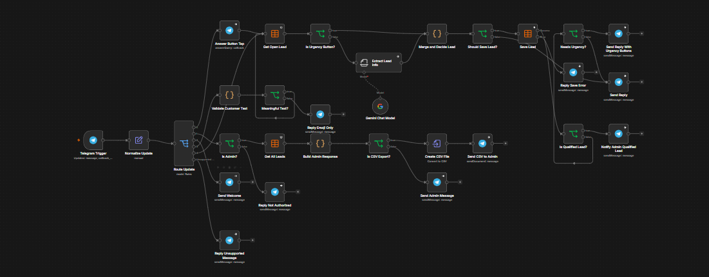
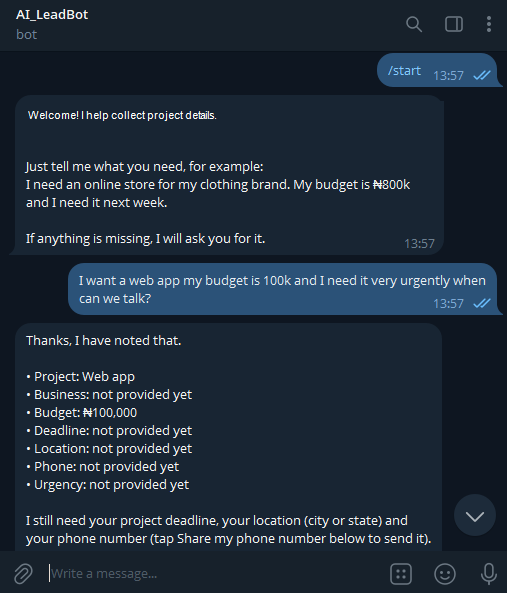
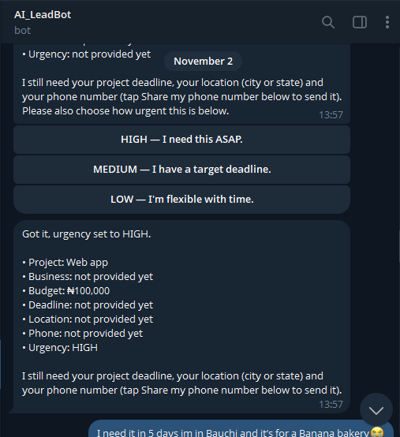

# AI Lead Qualifier for Telegram

An n8n automation that turns Telegram enquiries into structured, actionable leads for a web development business.

## Try the bot

[Open AI Lead Qualifier on Telegram](https://t.me/CTNG_LeadQualifier_bot)

## Screenshots

### Workflow overview

### Lead qualification conversation

The bot extracts the project details it can, then asks for the remaining information.

The customer chooses an urgency level and provides more project details.

### Qualified lead handoff

After the customer shares contact details and completes qualification, the workflow sends a lead notification. Personal contact information is redacted in this screenshot.

## What it does

1. Greets a new prospect and collects project requirements in Telegram.
2. Extracts project type, business type, budget, deadline, and location from the conversation.
3. Requests the customer's phone number through Telegram contact sharing.
4. Asks the customer to select an urgency level.
5. Saves the enquiry to an n8n Data Table and marks it qualified after the required details are present.
6. Sends a qualified lead summary to a fixed administrator Telegram account.

## Built with

- [n8n](https://n8n.io/) for workflow automation
- [Telegram Bot API](https://core.telegram.org/bots/api) for the customer conversation and contact sharing
- Gemini for extracting lead details from customer messages
- n8n Data Tables for lead records

## Privacy

The screenshots in this README have been edited to hide personal contact details. This showcase does not include the workflow export, API credentials, or the administrator's Telegram ID.

